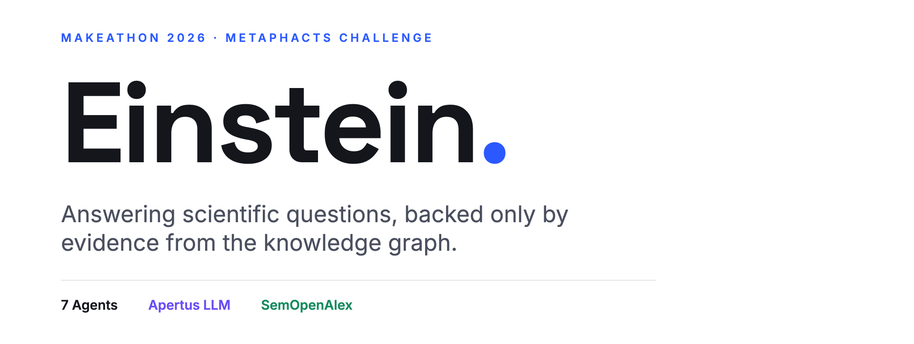
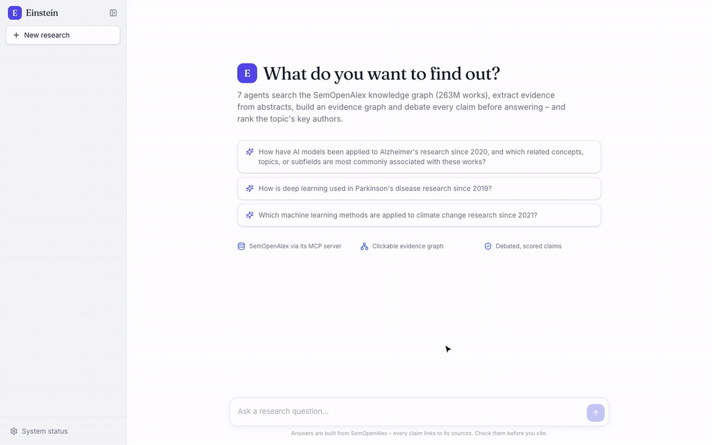
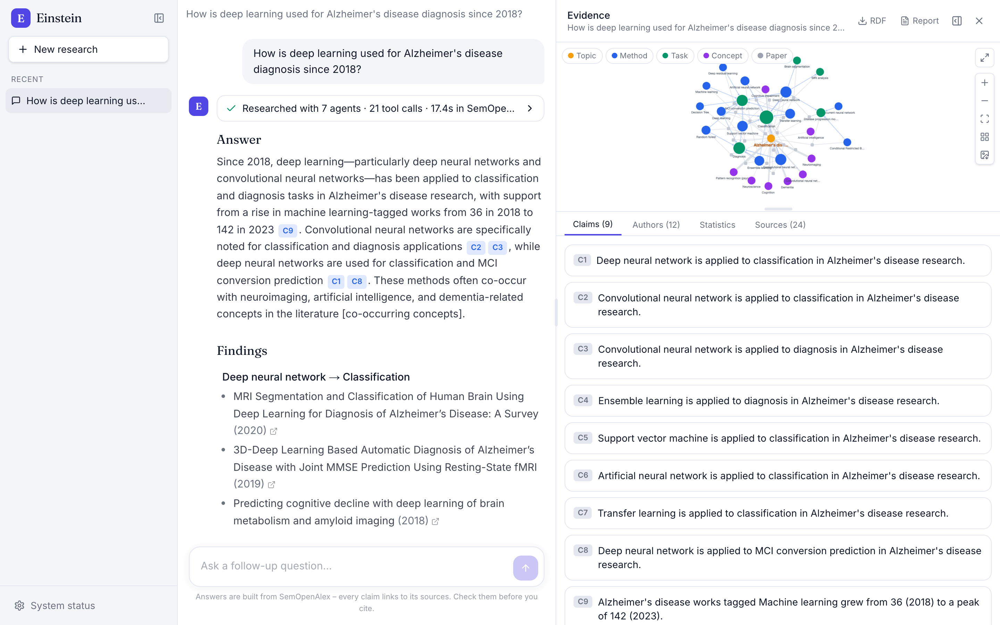
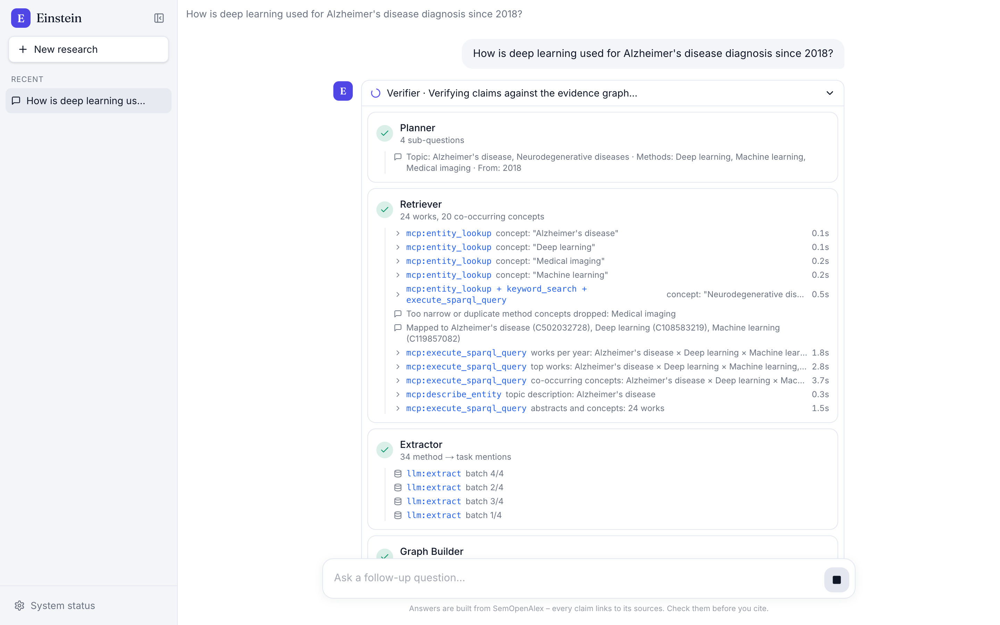
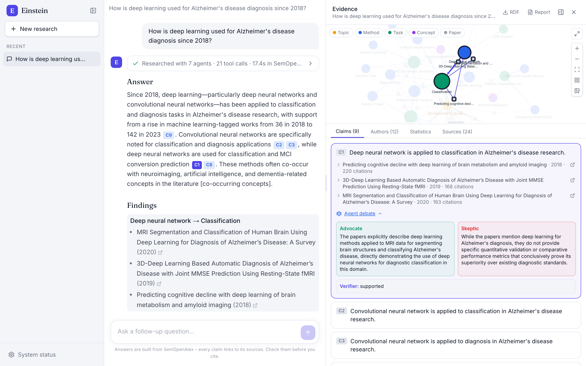
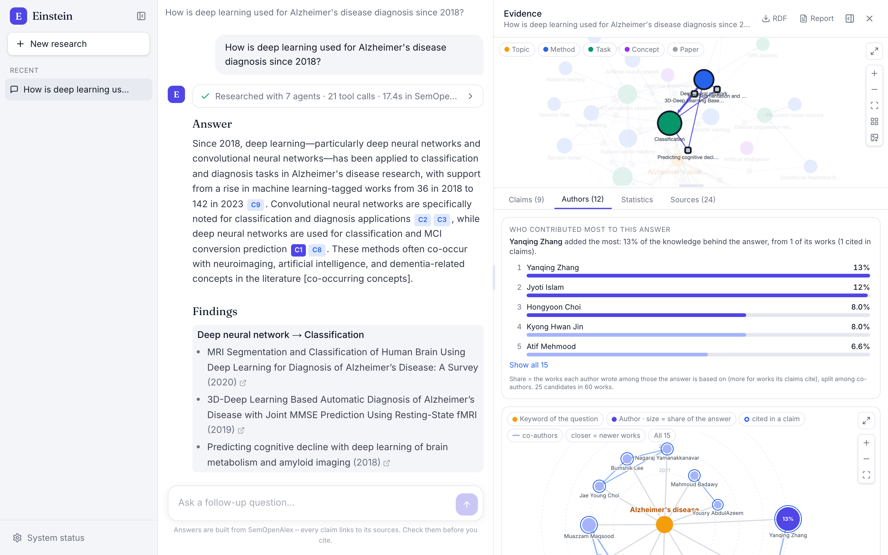
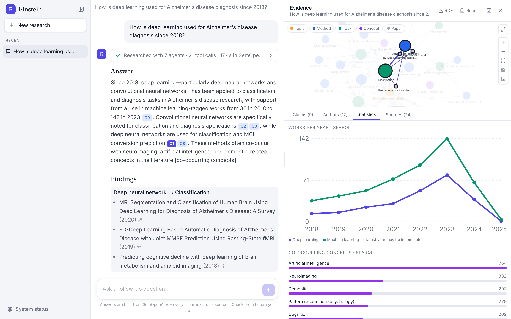
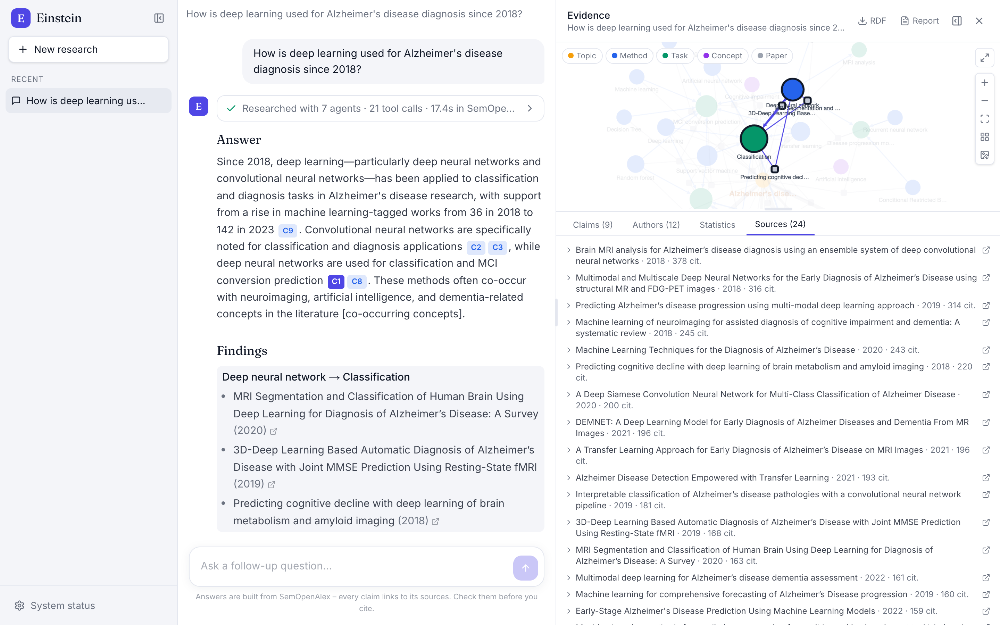
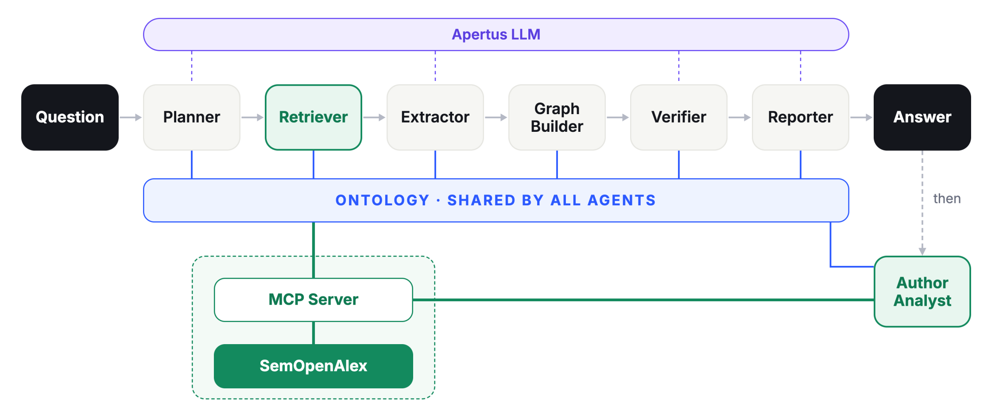

<p align="center">
  
</p>

<p align="center">
  <b>A multi-agent research assistant that answers scientific questions with evidence from the
  <a href="https://semopenalex.org">SemOpenAlex</a> knowledge graph — every statement traceable to its source papers.</b>
</p>

<p align="center">
  Built by team <b>Ground Zero</b> for the <b>metaphacts challenge</b> at <b>MAKEathon 2026</b>.
</p>

---

## Demo

<p align="center">
  
</p>

> *“How is deep learning used for Alzheimer's disease diagnosis since 2018?”* — seven agents query SemOpenAlex,
> read 24 highly cited papers, build an evidence graph, debate each claim and answer in well under a minute.
> The waiting phase is sped up in the GIF. Full-resolution video: [`docs/media/einstein-demo.mp4`](docs/media/einstein-demo.mp4).

## What is Einstein?

Large language models answer scientific questions fluently, but they rarely show *where* an answer comes from, and
sometimes they make the sources up. Einstein turns this around: **the knowledge graph is the only source of truth,
and the LLM only orchestrates.**

Ask a question in plain language (any language). Einstein maps it onto concepts in SemOpenAlex (260M+ scholarly
works), retrieves the most relevant papers, extracts *method → task* relations from their abstracts, assembles them
into an evidence graph and lets an advocate and a skeptic debate every candidate claim. The final answer is a
short report in which every finding (`[C1]`, `[C2]`, …) is clickable and leads to the papers that support it.
Statistics such as publication trends are counted in the graph with SPARQL, not guessed.

## Features

| | |
|---|---|
| **Evidence-grounded answers**<br>A 2–3 sentence answer, then the findings grouped as *method → task*, each with its supporting papers. Every `[Cn]` reference highlights its claim in the evidence graph. |  |
| **Live agent trace**<br>Watch each agent work: every MCP tool call, SPARQL query (expandable), timing and decision — e.g. why a concept was dropped or the search widened. |  |
| **Agent debate & confidence score**<br>Per claim, an *Advocate* and a *Skeptic* argue from the abstracts; the *Verifier* decides. The confidence score comes from source count, citation impact and recency. |  |
| **Key authors**<br>Who contributed most to this answer? A ranked list and a bubble graph of authors, their co-authors and how recent their work is — all from SemOpenAlex. |  |
| **Hard statistics via SPARQL**<br>Works per year and co-occurring concepts, counted directly in the knowledge graph. |  |
| **Sources & export**<br>All papers with year, citations and a link to SemOpenAlex. Export the evidence graph as **RDF/Turtle** with `prov:wasDerivedFrom` provenance (ready for metaphactory) and the report as **Markdown**. |  |

More:

- **Chat UI** with conversation history; follow-up questions in the same thread.
- **Robust against endpoint limits**: when a SPARQL query times out, Einstein falls back to sampling and per-year
  counts; when nothing matches, it widens the scope step by step and says so in the trace.
- **Optional web-search fallback**: if SemOpenAlex is unavailable, the chat *asks* whether to search the web
  instead. It never does so without consent, and web results are clearly marked.
- **metaphactory integration**: push any run into a local metaphactory/GraphDB and explore claims, methods, tasks and
  papers as linked data.

## How it works

<p align="center">
  
</p>

Seven agents run in sequence. They share **one ontology** ([`ontology/einstein.ttl`](ontology/einstein.ttl)), so
every agent speaks the same vocabulary as the knowledge graph. Only the Retriever and the Author Analyst touch the
data, and only through the **SemOpenAlex MCP server**. The **Apertus LLM** helps where language understanding is
needed, but never supplies facts.

| # | Agent | What it does | LLM? |
|---|---|---|---|
| 1 | **Planner** | Translates the question to English if needed, splits it into sub-questions and maps it onto SemOpenAlex concept labels: a *topic* (e.g. `Alzheimer's disease`), *methods* (e.g. `Deep learning`) and an optional start year. | ✓ |
| 2 | **Retriever** | Links the terms to `soa:Concept`s (`entity_lookup`, `keyword_search`) and fetches via SPARQL the 24 most cited works for *topic × methods*, their abstracts and concepts, works per year and co-occurring concepts. Drops concepts that are too narrow and widens the scope if nothing matches. | – |
| 3 | **Extractor** | Reads the abstracts in batches and extracts the concrete methods (`ein:Method`) and the tasks they address (`ein:Task`). Only what the text states. | ✓ |
| 4 | **Graph Builder** | Builds the evidence graph: *paper –uses→ method*, *paper –addresses→ task*, *method –appliedTo→ task* and *topic –coOccursWith→ concept*. Every edge stores the papers it was derived from. | – |
| 5 | **Verifier** | Turns the strongest `appliedTo` relations into claims, scores them and runs an *Advocate vs. Skeptic* debate per claim. Adds an exact trend claim from the SPARQL counts. | ✓ |
| 6 | **Reporter** | Writes the short answer from the claims that held up, citing them inline as `[C1]`, `[C2]`. No invented numbers, no percentages, weak claims phrased as tentative. | ✓ |
| 7 | **Author Analyst** | Runs *after* the answer is streamed: ranks the authors behind the answer (works, citations per year, h-index, fractional contribution) and maps their co-authorships. See [`docs/authors.md`](docs/authors.md). | – |

### Under the hood

**One route to the data.** All knowledge-graph access goes through `getSource()` in
[`lib/kg/source.ts`](lib/kg/source.ts), an MCP client for the SemOpenAlex MCP server. It discovers the server's
four tools at runtime (`execute_sparql_query`, `entity_lookup`, `keyword_search`, `describe_entity`), pages SPARQL
results past the server's 20-row preview and limits concurrent calls. There is no direct SPARQL endpoint and no
other data source.

**Ontology-checked queries.** SPARQL templates live in [`lib/kg/queries.ts`](lib/kg/queries.ts).
[`lib/kg/ontology.ts`](lib/kg/ontology.ts) loads `einstein.ttl` (Einstein's own classes like `ein:Claim`,
`ein:Method`, `ein:Task`, mapped onto the full SemOpenAlex ontology v4.0.0) and **refuses any query that uses a term
the ontology does not define**. The same ontology summary is injected into every LLM prompt (`withKg()`), so the
agents reason in the graph's vocabulary.

**Confidence score.** Each extracted claim is scored from its supporting papers:

```
confidence = 0.5 · min(1, sources / 5)                    # independent papers
           + 0.3 · min(1, log10(1 + citations) / 3)       # citation impact
           + 0.2 · share of sources from the last 3 years # recency

verdict:  ≥ 0.60 supported   ·   ≥ 0.35 weak   ·   otherwise rejected
```

The LLM debate can only **lower** this score, never raise it: *unsupported* caps it at 0.30, *weak* at 0.55.
Trend claims counted with SPARQL are exact and get 0.95.

**Graceful degradation.** Every LLM-backed agent has a rule-based fallback (lexicon-based planning and extraction,
evidence-based debate). Without an LLM key Einstein runs in **demo mode** on real SemOpenAlex data. When the
endpoint times out (~10 s), queries fall back to sampling and per-year counts.

**Streaming.** `/api/research` runs the pipeline in a Node function and streams every agent event (start, tool call,
log, result) as NDJSON, which the chat renders live. The author ranking follows as a separate event, so the MCP
server never sees retrieval and author queries at the same time.

**Provenance in the export.** [`lib/export.ts`](lib/export.ts) serialises the evidence graph as RDF/Turtle in
Einstein's vocabulary. SemOpenAlex resources keep their `soa:` type, and every claim and edge links back to its
papers with `prov:wasDerivedFrom`.

## Tech stack

| Layer | Technology |
|---|---|
| Frontend | Next.js 15 (App Router), React 19, Tailwind CSS 4, Cytoscape.js, d3-force |
| Agents & API | TypeScript, Node.js route handlers with NDJSON streaming |
| LLM | [Apertus](https://www.swiss-ai.org/apertus) (Swiss AI) via any OpenAI-compatible API |
| Knowledge graph | [SemOpenAlex](https://semopenalex.org) through its MCP server (`@modelcontextprotocol/sdk`) |
| Semantic web | RDF/Turtle with N3.js, own OWL ontology, metaphactory + GraphDB (optional) |
| Storage | Browser storage, or Supabase (optional) |

## Getting started

```bash
npm install
cp .env.example .env.local   # fill in the keys below
npm run dev                  # http://localhost:3000
```

| Variable | Purpose | Without it |
|---|---|---|
| `SEMOPENALEX_MCP_URL`, `SEMOPENALEX_MCP_AUTH` (or `SEMOPENALEX_MCP_KEY`) | SemOpenAlex MCP server. **Required**: all retrieval runs through its tools | Research runs fail with a clear message |
| `LLM_BASE_URL`, `LLM_API_KEY`, `LLM_MODEL` | Apertus (or any OpenAI-compatible host) | **Demo mode**: rule-based agents on real SemOpenAlex data |
| `OPENAI_API_KEY` | Optional web-search fallback (asked for consent first) | Fallback not offered |
| `SUPABASE_URL`, `SUPABASE_SERVICE_ROLE_KEY` | Store runs, claims and evidence graphs | Chats are kept in the browser only |
| `METAPHACTORY_URL`, `METAPHACTORY_GRAPHDB_URL` | Send evidence graphs to a local metaphactory | No metaphactory button |

- `npm run check:mcp` checks whether the MCP server answers (concept lookup, SPARQL, work → author links).
- `/settings` shows which services are active.
- For Supabase, run [`supabase/migrations/001_init.sql`](supabase/migrations/001_init.sql) in the SQL editor.

### metaphactory (local, Docker)

`./metaphactory/setup.sh` clones [metaphactory-docker-compose](https://github.com/metaphacts/metaphactory-docker-compose)
into `metaphactory-docker-compose/` (git-ignored) and starts **metaphactory 6.1 + GraphDB 10.8.8** (GraphDB 10 runs
in free mode). You need Docker Desktop and access to the metaphacts registry (token via metaphacts.com/get-started).

- metaphactory: http://localhost:10214 (admin / admin) · GraphDB Workbench: http://localhost:7200
- Set the two `METAPHACTORY_*` variables and restart. The evidence panel then shows a **metaphactory** button that
  writes the run into the named graph `https://einstein.app/kg/run/<id>` and opens its resource page.
- `./metaphactory/setup.sh down` stops the containers; the data stays in the Docker volumes.

### Deploy

Works on Vercel out of the box: import the repo and set the variables above. Agents run in a Node function
(`maxDuration` 300 s); no extra server is needed.

## Project structure

```
app/
  api/research/      # runs the pipeline, streams agent events as NDJSON
  api/authors/       # key-author analysis
  api/metaphactory/  # pushes a run into metaphactory / GraphDB
  settings/          # service status page
components/          # Chat, AgentTimeline, Report, EvidencePanel, EvidenceGraph, AuthorBubbles, …
lib/
  agents/pipeline.ts # orchestrator + the agents (LLM path and rule-based fallback each)
  kg/source.ts       # MCP client – the only route to SemOpenAlex
  kg/queries.ts      # SPARQL templates with timeout fallbacks
  kg/ontology.ts     # loads the ontology, rejects unknown terms, describes it for prompts
  kg/authors.ts      # key-author ranking (weights in lib/config/authors.ts)
  llm/index.ts       # OpenAI-compatible adapter for Apertus
  export.ts          # RDF/Turtle export with provenance
ontology/einstein.ttl  # Einstein's ontology on top of SemOpenAlex (v4.0.0, CC0)
docs/                  # author-ranking details, pipeline diagram, media
```

## Team

**Ground Zero**

| | GitHub |
|---|---|
| Joaquin Renz | [@joaquin4053](https://github.com/joaquin4053) |
| Nicolas Stöckli | [@nicolasstoeckli-entr](https://github.com/nicolasstoeckli-entr) |
| Fabian Ritz | [@wotanderbeste-dot](https://github.com/wotanderbeste-dot) |

## Access & license

Einstein needs your own credentials for the SemOpenAlex MCP server and the LLM. None are included in this
repository, and the MCP server cannot be used without them.

No license is granted: © 2026 Joaquin Renz, Nicolas Stöckli, Fabian Ritz. All rights reserved. You may view the
code, but not copy, modify or redistribute it without permission.

## Acknowledgements

- [metaphacts](https://metaphacts.com) for the challenge and the SemOpenAlex MCP server
- [SemOpenAlex](https://semopenalex.org) (based on [OpenAlex](https://openalex.org)) for the open scholarly knowledge graph
- [Swiss AI Initiative](https://www.swiss-ai.org) for the Apertus models
- MAKEathon 2026 organisers
